# comfy-custom-workflow

Custom ComfyUI nodes and workflows for **face swapping** (images and video, with
manual or identity-based mapping), **text removal / replacement** in images, and
**Stable Diffusion 3.5 Large** and **FLUX.1 [dev]** generation from text or from an
input image.

Everything here runs locally. Built and tested on a 6 GB GPU.

---

## Contents

```
custom_nodes/
  comfyui-face-tools/     8 nodes - face detection, mapping, identity matching
  comfyui-text-tools/     6 nodes - OCR text detection, erase, retype
workflows/                15 ready-to-run workflows
tools/
  download_models.py      fetches every model needed
  validate_workflows.py   checks workflows against a running ComfyUI
docs/SETUP_NOTES.md       build notes, benchmarks, gotchas
```

---

## Environment

Tested on:

| | |
|---|---|
| OS | Windows 11 |
| GPU | NVIDIA RTX 2060, **6 GB** VRAM |
| Driver | 561.17 (supports up to CUDA 12.6) |
| CUDA toolkit | 12.6 |
| Python | 3.11.9 |
| PyTorch | 2.14.0+cu126 |
| onnxruntime-gpu | **1.22.0** (CUDA 12 build - see below) |
| RAM | 24 GB |

Nothing here needs a big GPU. The heaviest model is `inswapper_128`, which works
on 128x128 face crops. 6 GB is comfortable; the practical limits are **system RAM**
for long videos and **wall-clock time**, not VRAM.

### The onnxruntime trap (read this)

`onnxruntime-gpu` ships separate builds per CUDA major version, and **picking the
wrong one does not error** - it prints a warning most people never see, falls back
to CPU, and runs about **20x slower**.

| onnxruntime-gpu | needs CUDA | needs driver |
|---|---|---|
| 1.22.x | 12.x | >= 525 |
| 1.23+ | 13.x | >= 580 |

Measured on this machine (`inswapper_128`, one inference):

| | Provider | Time |
|---|---|---|
| onnxruntime-gpu 1.30 on a CUDA-12 driver | `CPUExecutionProvider` (silent fallback) | **1115.6 ms** |
| onnxruntime-gpu 1.22 | `CUDAExecutionProvider` | **51.3 ms** |

**Check yours:**

```bash
python -c "import torch, onnxruntime as ort; \
s=ort.InferenceSession('models/insightface/inswapper_128.onnx', providers=['CUDAExecutionProvider']); \
print(s.get_providers())"
```

Must print `['CUDAExecutionProvider', ...]`. If it says `CPUExecutionProvider`,
install the build matching your driver (`pip install onnxruntime-gpu==1.22.0`).
`import torch` first - it loads the CUDA/cuDNN DLLs onnxruntime then reuses.

On Python 3.14 there is no `onnxruntime-gpu==1.22.0` wheel. Use the CUDA 12 build
of a newer release from Microsoft's feed instead (tested: 1.24.4 on a P100):

```bash
pip install onnxruntime-gpu==1.24.4 \
  --extra-index-url https://aiinfra.pkgs.visualstudio.com/PublicPackages/_packaging/onnxruntime-cuda-12/pypi/simple/
```

The default PyPI builds of 1.23+ are CUDA 13, which dropped Pascal GPUs (P100).

---

## Install

### 1. Clone

```bash
git clone git@github.com:HarryChen1995/comfy-custom-workflow.git
cd comfy-custom-workflow
```

### 2. Install the nodes and workflows

One script does both. It finds ComfyUI on its own:

```bash
python tools/install.py
```

```
python tools/install.py            # LINK (default) - edits flow both ways
python tools/install.py --copy     # COPY - snapshot, repo and ComfyUI independent
python tools/install.py --check    # report what is currently installed
python tools/install.py --uninstall
python tools/install.py --comfy D:\AI\ComfyUI    # if auto-detect fails
```

It wires up three paths:

| Repo | ComfyUI |
|---|---|
| `workflows/` | `user/default/workflows/` |
| `custom_nodes/comfyui-face-tools/` | `custom_nodes/comfyui-face-tools/` |
| `custom_nodes/comfyui-text-tools/` | `custom_nodes/comfyui-text-tools/` |

**LINK vs COPY.** Link mode uses a directory junction on Windows (no admin
needed) or a symlink elsewhere, so the repo *is* the live folder: save a
workflow in ComfyUI and it shows up as a change in `git status`, ready to
commit. Copy mode takes a snapshot instead - use it if you'd rather the two
stay independent, but remember you'll then have to copy changes back by hand.

Anything already in those folders is moved to
`ComfyUI/_backup_before_install/` first, never deleted. Re-running is safe -
already-linked paths are left alone.

#### Doing it manually

Nothing magic is going on, if you'd rather not run the script:

```bash
# Windows - link
mklink /J C:\ComfyUI\user\default\workflows          %CD%\workflows
mklink /J C:\ComfyUI\custom_nodes\comfyui-face-tools %CD%\custom_nodes\comfyui-face-tools
mklink /J C:\ComfyUI\custom_nodes\comfyui-text-tools %CD%\custom_nodes\comfyui-text-tools

# Windows - copy
xcopy /E /I custom_nodes\comfyui-face-tools C:\ComfyUI\custom_nodes\comfyui-face-tools
xcopy /E /I custom_nodes\comfyui-text-tools C:\ComfyUI\custom_nodes\comfyui-text-tools
copy  workflows\*.json C:\ComfyUI\user\default\workflows\

# macOS / Linux - link
ln -s "$PWD/workflows"                      ~/ComfyUI/user/default/workflows
ln -s "$PWD/custom_nodes/comfyui-face-tools" ~/ComfyUI/custom_nodes/
ln -s "$PWD/custom_nodes/comfyui-text-tools" ~/ComfyUI/custom_nodes/
```

### 3. How workflows get "registered"

There is no registration step. ComfyUI lists **every `.json` in
`user/default/workflows/`** in the sidebar **Workflows** tab (folder icon).
Dropping a file there is the whole process.

- New or changed `.json` -> press **F5**, that's enough
- New or changed node **`.py`** -> **restart the server**; F5 never re-imports Python

You can also bypass the folder entirely: **Workflow -> Open** and pick a `.json`
from anywhere, or drag the file onto the canvas.

### 4. Install the Python dependencies

Into the **same** interpreter ComfyUI runs on:

```bash
C:\ComfyUI\venv\Scripts\python.exe -m pip install -r requirements.txt
```

### 5. Install ComfyUI-ReActor

The face workflows build on it:

```bash
cd C:\ComfyUI\custom_nodes
git clone https://github.com/Gourieff/ComfyUI-ReActor.git
```

The text workflows also need
[comfyui-inpaint-nodes](https://github.com/Acly/comfyui-inpaint-nodes).

### 6. Download the models

No arguments - it finds ComfyUI on its own:

```bash
python tools/download_models.py
```

```
python tools/download_models.py --list        # show the list, download nothing
python tools/download_models.py --skip sd     # skip the 6.5 GB SDXL checkpoint
python tools/download_models.py --skip sd35   # skip the 21.7 GB SD 3.5 Large set
python tools/download_models.py --skip flux   # skip the 17.2 GB FLUX.1 dev checkpoint
python tools/download_models.py --comfy D:\AI\ComfyUI    # if auto-detect fails
```

Already-present files are skipped by byte count; interrupted downloads resume.
If Hugging Face answers `HTTP 429 ... server under pressure`, it is their side, not
yours - wait a few minutes and run the script again. You can also fetch a file with
a logged-in `hf` CLI (`hf auth login`), e.g.
`hf download Comfy-Org/flux1-dev flux1-dev-fp8.safetensors --local-dir <ComfyUI>/models/checkpoints`.

| Model | Size | Goes to | For |
|---|---|---|---|
| `inswapper_128.onnx` | 528 MB | `models/insightface/` | face swap |
| `GFPGANv1.4.pth` | 332 MB | `models/facerestore_models/` | face restore |
| `big-lama.pt` | 196 MB | `models/inpaint/` | text erase |
| `sd_xl_turbo_1.0_fp16.safetensors` | 6.5 GB | `models/checkpoints/` | text-to-image only |
| `sd3.5_large_fp8_scaled.safetensors` | 14.9 GB | `models/checkpoints/` | SD 3.5 workflows |
| `clip_l.safetensors` | 246 MB | `models/text_encoders/` | SD 3.5 workflows |
| `clip_g.safetensors` | 1.4 GB | `models/text_encoders/` | SD 3.5 workflows |
| `t5xxl_fp8_e4m3fn_scaled.safetensors` | 5.2 GB | `models/text_encoders/` | SD 3.5 workflows |
| `flux1-dev-fp8.safetensors` | 17.2 GB | `models/checkpoints/` | Flux workflows (CLIP-L, T5 and VAE are inside) |

`buffalo_l` (face detection + ArcFace), the EasyOCR models, and ReActor's
GFPGAN helpers (`detection_Resnet50_Final.pth`, `parsing_parsenet.pth`) and NSFW
check download themselves on first use - the first face-swap run pauses while
they arrive (~0.6 GB).

The SD 3.5 files come from the ungated
[Comfy-Org/stable-diffusion-3.5-fp8](https://huggingface.co/Comfy-Org/stable-diffusion-3.5-fp8)
mirror. The official `stabilityai/stable-diffusion-3.5-large` repo is gated and
needs an accepted licence plus a Hugging Face token. SD 3.5 is released under the
Stability AI Community License.

The Flux file comes from the ungated
[Comfy-Org/flux1-dev](https://huggingface.co/Comfy-Org/flux1-dev) mirror; the
official `black-forest-labs/FLUX.1-dev` repo is gated. FLUX.1 [dev] is under the
FLUX.1 [dev] Non-Commercial License.

### 7. Restart ComfyUI

**Custom node Python only loads at startup.** F5 reloads the UI and the workflow
list but never re-imports nodes. After copying or editing nodes, restart the
server.

### Verify

```bash
python tools/validate_workflows.py       # needs ComfyUI running on :8188
```

Checks every workflow against the live node schema - missing node types, wrong
widget counts, values of the wrong type. Should print `ALL CLEAN`.

---

## Which workflow do I want?

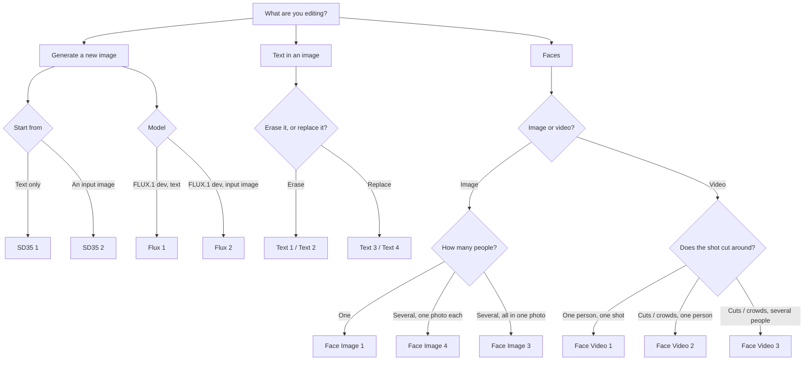

---

## The workflows

### Face Image 1 - Multi-face from one photo

Simplest case: one source photo, swap one or more faces in one target image,
selected by index.

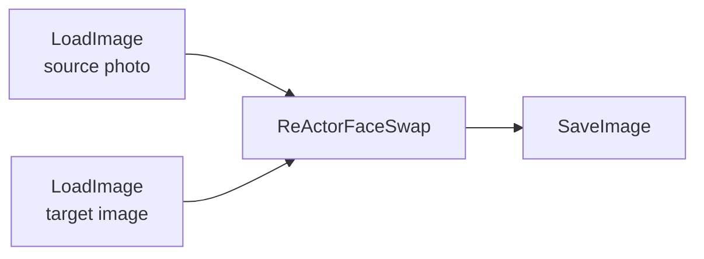

Set `source_faces_index` / `input_faces_index` to comma lists (`0,1` -> `2,3`)
to do several at once.

---

### Face Image 2 - Multi-face chained

Different source photo per person, by chaining one swap node per face.

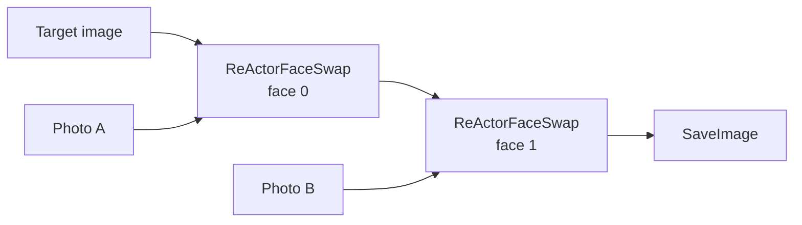

---

### Face Image 3 - Manual face mapping

Numbers every face in both images so you can map them by hand.

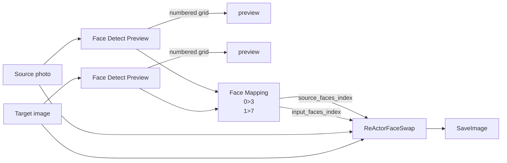

Run once, read the numbers off the contact sheets, type `photoFace>targetFace`
one pair per line, run again.

---

### Face Image 4 - Multi-photo mapping

Same idea but **one uploaded photo per person** instead of one photo containing
everybody. Chain a `Source Photo Set` node per photo; each gets an index and a
label.

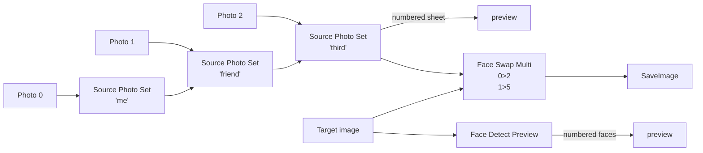

Add a person by copying one `LoadImage -> Source Photo Set` pair and pointing its
`append_to` at the previous one. No limit.

---

### Text 1 - Remove (manual mask)

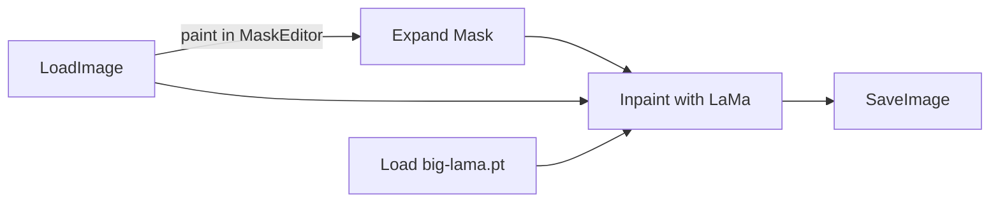

Right-click the image -> **Open in MaskEditor**, paint over the text, **Save to
node**. If you skip the save you get
`Image and mask must be the same size ... torch.Size([64, 64])` - that 64x64 is
ComfyUI's placeholder for "no mask".

---

### Text 2 - Remove (auto OCR)

No painting - OCR finds the text and builds the mask.

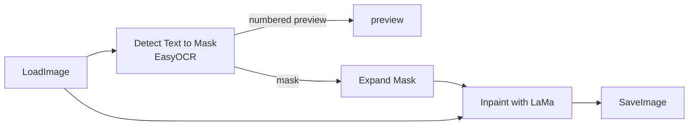

`mask_mode = glyphs` masks only the letter pixels rather than a rectangle -
much cleaner on busy backgrounds, because LaMa fills thin strokes well but
smears when asked to invent a large block.

---

### Text 3 - Replace (auto OCR)

Erase, then retype in the original colour.

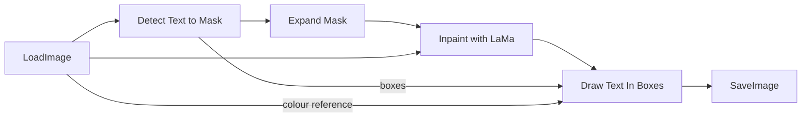

`color = auto` samples the original glyph colour with Otsu. Font size auto-fits
the box unless you set `font_size`.

---

### Text 4 - Replace (pick box, move, retype)

Adds selection and repositioning.

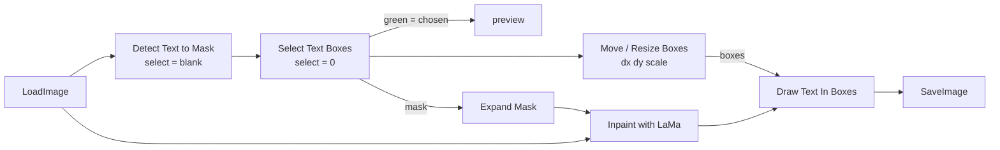

Erase position comes from the **mask**, draw position from the **boxes** - so
feeding the mask from before `Move` and the boxes from after erases in the old
spot and retypes in the new one.

---

### Face Video 1 - Index mapping

Detect faces on **one** reference frame, map by index, apply to every frame.

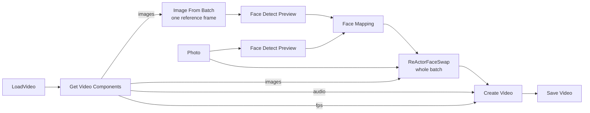

Resolution, fps and audio carry through automatically.

**Limitation:** ReActor re-detects every frame and sorts by face size, so index
`0` means *the biggest face in that frame*, not a person. Fine for one dominant
subject in one continuous shot; it follows the wrong face across cuts.

---

### Face Video 2 - Identity match (1 person)

Picks the target by **face recognition** instead of position.

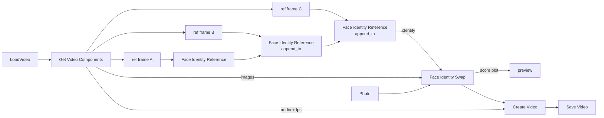

Per frame it embeds every face, scores them against your references (cosine
similarity), swaps the best match, and **leaves the frame alone** if nothing
clears `similarity_threshold`.

**Why several references?** One reference only covers one look. Measured:

| Comparison | Score |
|---|---|
| Same person, same shot | 0.81 - 1.00 |
| Same person, different angle / hat | 0.45 - 0.65 |
| Same person **with vs without sunglasses** | **0.24** |
| Different people | below ~0.30 |

ArcFace leans on the eye region, so eyewear reads almost like a different
identity. Chain a reference per look and the best match wins.

The **score plot** output shows green (swapped), amber (below threshold) and
grey ticks (no face) per frame - set the threshold from that, don't guess.

---

### Face Video 3 - Identity match (multi photo)

Several people, one uploaded photo each.

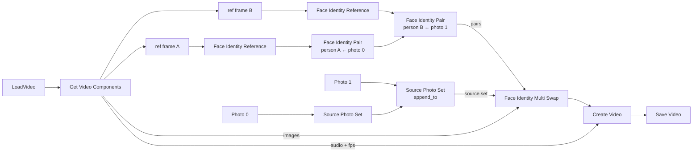

Each frame builds a score matrix of *detected face x person* and assigns
greedily: highest score first, then that face **and** that person are removed
from consideration. So one frame can never give two people the same face, or one
person two faces.

The score plot draws one coloured line per person, with gaps where they were not
detected.

---

### SD35 1 - Text to image

Stable Diffusion 3.5 Large from a text prompt. No custom nodes - stock ComfyUI.

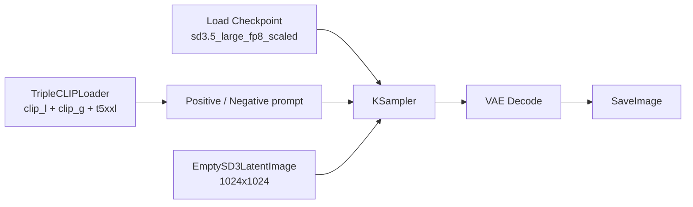

Defaults: 28 steps, cfg 4.5, `euler` / `sgm_uniform`, 1024x1024.

---

### SD35 2 - Image to image

Same model, but starts from an uploaded image instead of an empty latent. The
prompt still steers the result.

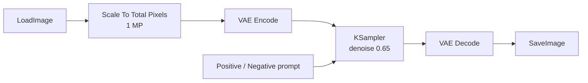

`denoise` decides how far the result drifts: lower stays close to the input
image, higher follows the prompt more. The input is scaled to about 1 MP so large
photos don't run out of memory.

---

### Flux 1 - Text to image

FLUX.1 [dev] from a text prompt. Stock ComfyUI nodes only, one checkpoint file.

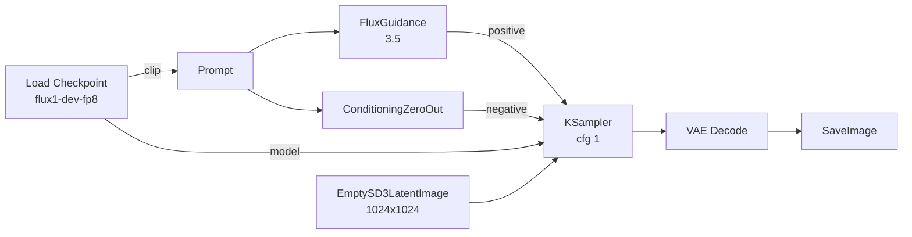

Flux is guidance-distilled: `cfg` stays at 1 and the prompt strength comes from
**FluxGuidance** (3.5). The negative input is required by the sampler but ignored,
so it is zeroed. Defaults: 20 steps, `euler` / `simple`.

---

### Flux 2 - Image to image

Same model, starting from an uploaded image.

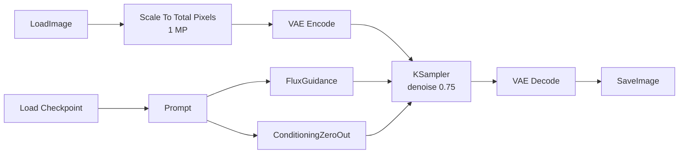

Lower `denoise` stays closer to the input image.

---

## Node reference

### comfyui-face-tools

| Node | What it does |
|---|---|
| **Face Detect Preview** | Numbers every face; outputs an annotated image, a cropped contact sheet, boxes, a report and a count |
| **Face Mapping** | `photoFace>targetFace` lines -> the two index strings ReActor wants |
| **Source Photo Set** | Chain one per uploaded photo; numbers and labels them |
| **Face Swap Multi** | Index mapping with one photo per person, any batch size |
| **Face Identity Reference** | Captures the ArcFace embedding of one person; chain for multiple looks |
| **Face Identity Swap** | Swaps that person wherever they appear, skips frames they're absent from |
| **Face Identity Pair** | Binds one person to one source photo |
| **Face Identity Multi Swap** | Several people at once, greedy one-to-one assignment |

Face indices come from ReActor's own `analyze_faces` + `sort_by_order`, so the
numbers shown are exactly the ones ReActor swaps with. Default order is
`large-small` - **face 0 is the biggest face, not the leftmost**.

### comfyui-text-tools

| Node | What it does |
|---|---|
| **Detect Text to Mask** | EasyOCR -> mask + numbered preview; `select`, `contains`, `invert_selection`, `detect_scale`, `mask_mode` box/glyphs |
| **Select Text Boxes** | Narrow to specific boxes - lets you erase one set and retype another |
| **Move / Resize Text Boxes** | `dx`, `dy`, `scale_w`, `scale_h` |
| **Draw Text In Boxes** | Retype: colour (`auto` / hex / name / per-box), font, size, bold, align, valign, offset, rotation, opacity, outline |
| **Text Boxes From Painted Mask** | Paint a region instead of relying on OCR |
| **Manual Text Box** | Explicit x / y / width / height |

---

## Performance

Measured on the RTX 2060, 6 GB, after the onnxruntime fix.

| Task | Result |
|---|---|
| Face swap, 640x360 video | **0.63 s/frame** without restore, **0.88 s/frame** with GFPGAN |
| Identity swap, 360x360, 519 frames | **0.9 min** total (0.10 s/frame) |
| LaMa text erase, 5250x7462 (39 MP) | 12 s |
| SDXL Turbo 512x512, 4 steps | 8 s warm |

Measured on a Tesla P100 16 GB (Linux, 22 GB RAM, torch 2.14.1+cu126). The P100
has no tensor cores and no bf16/fp8 hardware, so SD 3.5 weights are upcast as they
run; output is clean fp16, just slow.

| Task | Result |
|---|---|
| SD35 1 - Text to image, 1024x1024, 28 steps | **421 s** first run (includes model load) |
| SD35 2 - Image to image, ~1 MP, 28 steps, denoise 0.65 | **325 s** (models already loaded) |
| Flux 1 - Text to image, 1024x1024, 20 steps | **354 s** first run (includes model load) |
| Flux 2 - Image to image, ~1 MP, 20 steps, denoise 0.75 | **270 s** (models already loaded) |

Identity matching is faster than index matching on real footage because frames
below threshold skip the swap and the restore entirely - on a montage clip that
was 1480 of 1772 frames.

**Memory, not VRAM, is the video limit.** All frames load as one batch:
~2.8 MB per 640x360 frame as float32, and several copies exist at once. ~500
frames is comfortable on 24 GB; for longer clips trim first or process in chunks
with `Image From Batch` (`batch_index` = start, `length` = how many).

---

## Gotchas

- **Changed a node's Python? Restart the server.** F5 never re-imports nodes.
- **New workflow `.json`? F5 is enough.**
- **One ComfyUI at a time** - a second fails with `Database is locked`.
- **Face numbering shifts with resolution.** The detector finds a different
  number of faces at different sizes (a 375x533 poster gave 19 faces, the same
  image at half size gave 15). Read the numbers and swap at the same size.
- **`inswapper_128` outputs 128x128 per face.** Faces much smaller or larger
  than that come out soft. Upscale small footage before swapping.
- **ReActor's `det_size` bug:** it seeds its model cache with only the keys
  `"320"` and `"640"` and then does a bare dict lookup, so any other value
  raises `KeyError`. `comfyui-face-tools` pre-seeds the key instead of patching
  ReActor, so a ReActor update won't undo the fix.

---

## Licence notes

The code in this repo is free to use. The **models are not all equal**:

- `inswapper_128.onnx` and `buffalo_l` are InsightFace models -
  **non-commercial / research use only**
- `GFPGANv1.4.pth` is Apache-2.0
- `big-lama.pt` - see the LaMa project

Only swap faces you have permission to use.
